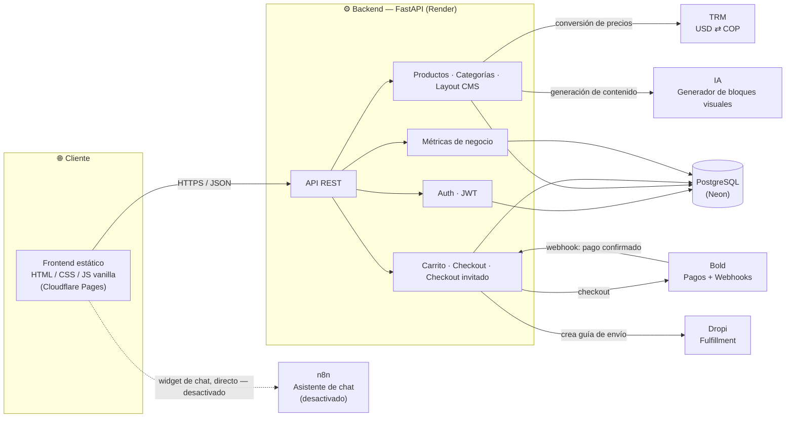

<div align="center">

# 🛍️ Velonox Store

**Plataforma de e-commerce full-stack construida con FastAPI, PostgreSQL y JavaScript vanilla**

Autenticación · Catálogo · Carrito · Checkout (registrado e invitado) · Pagos · Panel administrativo · CMS visual · Métricas de negocio

### 🔗 [velonox.co](https://velonox.co)

[](https://www.python.org/)
[](https://fastapi.tiangolo.com/)
[](https://www.postgresql.org/)
[](https://www.sqlalchemy.org/)
[](https://alembic.sqlalchemy.org/)
[](#)
[](https://render.com/)
[](https://neon.tech/)
[](https://velonox.co)
[](#)

</div>

---

## 📌 Tabla de contenidos

- [Sobre el proyecto](#-sobre-el-proyecto)
- [Estado actual](#-estado-actual)
- [Arquitectura](#-arquitectura)
- [Características](#-características)
- [Stack técnico](#-stack-técnico)
- [Estructura del proyecto](#-estructura-del-proyecto)
- [Instalación rápida](#-instalación-rápida)
- [Cómo correr los tests](#-cómo-correr-los-tests)
- [Variables de entorno](#-variables-de-entorno)
- [Despliegue](#-despliegue)
- [Mantenimiento continuo](#-mantenimiento-continuo)

---

##  Sobre el proyecto

**Velonox Store** es una tienda online construida desde cero con un enfoque comercial completo: no es solo un catálogo con carrito, sino una plataforma con panel administrativo, edición visual del layout, checkout invitado, integración con pasarelas de pago y fulfillment, y un sistema de moneda dinámico USD/COP.

El backend expone una API REST con **FastAPI** sobre **PostgreSQL** (SQLAlchemy 2.x, patrón síncrono), y el frontend es **HTML, CSS y JavaScript vanilla**, sin frameworks — priorizando control total y rendimiento sobre el "boilerplate" de un SPA.

##  Estado actual

**La tienda está finalizada y operando en producción** en [velonox.co](https://velonox.co). Todos los módulos core están completos y estables.

> **Noviembre 2026 — migración de infraestructura:** el backend se movió de Railway a **Render** (plan gratis) y la base de datos a **Neon** (Postgres gratis), para dejar de pagar hosting mientras la tienda arranca. La base de Neon empezó **vacía** (en Railway solo había productos de prueba), así que el catálogo real se carga desde el panel admin. Ver [Despliegue](#-despliegue).

| Módulo | Estado |
|---|---|
| Autenticación (JWT) | ✅ Operativo |
| Catálogo, productos y categorías | ✅ Operativo |
| Carrito y checkout (registrado / invitado) | ✅ Operativo |
| Pagos con Bold (webhooks + firma de integridad) | ✅ Operativo |
| Fulfillment con Dropi | ✅ Operativo |
| CMS visual del layout (con historial y restauración) | ✅ Operativo |
| Panel administrativo | ✅ Operativo |
| Métricas de negocio | ✅ Operativo |
| Conversión USD/COP vía TRM | ✅ Operativo |
| Testing automatizado (backend) | ✅ ~95% cobertura |
| Rate limiting, logging de seguridad y protección contra enumeración de usuarios | ✅ Operativo |
| Widget de chat (n8n) | ⏸️ Desactivado temporalmente (su n8n estaba en Railway) |

De aquí en adelante, el trabajo sobre el repositorio consiste en **nuevas implementaciones puntuales y corrección de bugs** que se detecten en producción, no en desarrollo de funcionalidades base.

## 🏗️ Arquitectura



##  Características

<table>
<tr>
<td valign="top" width="50%">

### Frontend

- Home con catálogo destacado y contenido visual administrable
- Detalle de producto con descripción, specs, características y relacionados
- Carrito con actualización de cantidades y eliminación de ítems
- Checkout con dos modalidades: pago anticipado y contraentrega
- Checkout invitado sin registro previo
- Panel administrativo para layout, productos, categorías, marca y métricas
- Páginas institucionales, contacto, políticas y sets
- Carga rápida: peticiones en paralelo, caché local de la última versión de cada página y esqueleto animado en la primera visita
- Widget de chat (asistente virtual) conectado a n8n — *desactivado temporalmente; el código se conserva en `js/velonox-chat-widget.js`*

</td>
<td valign="top" width="50%">

### Backend

- API REST con FastAPI y autenticación JWT
- Gestión de usuarios, productos, categorías, carritos, órdenes y páginas de producto
- Integración con pagos y webhooks de Bold (firma de integridad + confirmación de estados)
- Creación automática de órdenes de envío en Dropi
- CMS de layout con bloques configurables, historial de versiones y restauración
- Endpoints de métricas de negocio, checkout invitado, TRM y ajustes de tienda
- Arquitectura preparada para nuevos servicios y funcionalidades

</td>
</tr>
</table>

##  Novedades recientes

> Con la tienda en producción, esta sección funciona como changelog: nuevas implementaciones y correcciones de bugs encontrados sobre la marcha.

- **Migración de infraestructura (noviembre 2026):** Railway se dio de baja por costo y el proyecto se movió a servicios con plan gratis:
  - **Backend → Render** (`https://velonox.onrender.com`). El plan gratis duerme el servicio tras 15 min sin tráfico; un cron externo (cron-job.org) llama a `/health` cada 10 min para mantenerlo despierto (las 750 h/mes gratis alcanzan para un servicio 24/7).
  - **Base de datos → Neon** (Postgres gratis, connection string *pooled*). Se agregó `pool_pre_ping` en `database.py` porque Neon cierra las conexiones inactivas al suspenderse, y se limpió el archivo, que estaba duplicado.
  - **Bug encontrado en la migración:** la cadena de migraciones de Alembic **no podía construir una base vacía**. Las tablas `categories` y `product_pages`, y varias columnas de `orders`, se habían creado a mano en la base de Railway y nunca quedaron en ninguna migración, así que `alembic upgrade head` fallaba en Neon. Se agregó `backend/init_db.py`: en una base nueva crea el esquema desde los modelos y la marca con `alembic stamp head`; en una base existente corre `alembic upgrade head` como siempre. Es el nuevo comando de arranque.
  - URL del backend actualizada en los 8 archivos del frontend que la tenían fija, y URL del webhook actualizada en el panel de Bold (`/payments/bold/webhook`).
  - El widget de chat se desactivó (se quitó el `<script>` de las 10 páginas) porque su instancia de n8n también vivía en Railway. El archivo se conserva para reactivarlo.
- **Rendimiento de carga (noviembre 2026):** con ~0.5 s por petición en Render, las páginas encadenaban 4-5 peticiones en fila (TRM → usuario → layout → productos) y mostraban 2-3 s de pantalla en blanco bajo el header. Se corrigió:
  - Todas las peticiones independientes salen en paralelo; `getMe()` del nav ya no bloquea el contenido.
  - `apiFetch()` solo envía `Content-Type` cuando hay body: en los GET provocaba un preflight CORS extra.
  - El home y las páginas de contenido muestran al instante la última versión guardada en `localStorage` y solo vuelven a pintar si el backend devuelve algo distinto. La TRM también se guarda.
  - Esqueleto animado en el home durante la primera visita.
  - Resultado medido: el home pasó de ~2-3 s a ~1 s en la primera visita y a **~0.1 s** en visitas repetidas; el catálogo, de ~1.3 s a ~0.7 s. El carrito y el checkout siguen esperando la TRM fresca a propósito, para que el total mostrado coincida con lo que cobra Bold.
- **Orden del repositorio (noviembre 2026):** se agregó `.gitattributes` (todo el repo en LF). Editar en Windows marcaba ~50 archivos como modificados sin ningún cambio real. Se sacó `node_modules/` del repo (no lo usa nada: `motion` se carga desde CDN) y se agregó al `.gitignore`. `backend/.env.example` ahora incluye `RESEND_API_KEY` y `GOOGLE_CLIENT_ID`, que faltaban.

- Integración de autenticación con Google Identity Services en la página de login, con endpoint backend para validar el token de Google y crear o reutilizar la cuenta del usuario.
- Flujo de acceso híbrido que soporta login con email/contraseña y login social, incluyendo la creación automática de carrito para usuarios que ingresan por Google.
- Mejoras en el panel administrativo con previsualización en vivo del layout y soporte para historial y restauración de versiones previas del CMS visual.
- Widget de chat propio (`frontend/js/velonox-chat-widget.js`) enlazado en las páginas comerciales (home, catálogo, categorías, producto, carrito, checkout, institucionales, regalos y sets), no en páginas de autenticación/confirmación/admin. Envía los mensajes directamente desde el navegador a un webhook de n8n que orquesta la lógica del asistente; mantiene la conversación por sesión de visitante vía `localStorage`.
- Nueva pestaña "Pedidos" en el panel administrativo: listado completo de órdenes (no solo las 8 más recientes de Métricas), con filtros por estado/método de pago/búsqueda, cambio manual de estado y un indicador visual de si el pago con Bold fue confirmado, pendiente o rechazado — necesario mientras no se cuenta con credenciales de Dropi para automatizar contraentrega. Cada pedido tiene un detalle expandible con dirección de envío, teléfono, tipo/número de documento, código DANE de la ciudad y referencias Bold/Dropi, para poder crear la guía de envío en Dropi manualmente.
- Corrección de bug real: el webhook de Bold no actualizaba el estado de los pedidos porque el payload real que envía Bold (formato tipo CloudEvents, con el estado en `type` y la referencia en `data.metadata.reference`) no coincidía con la estructura que asumía el backend; se corrigió el parseo.
- Corrección de bug real: CORS no incluía el método `PATCH`, lo que rompía con un 400 en preflight el cambio de estado de pedidos desde el admin.
- Suite de tests automatizados para el backend (`backend/tests/`, pytest), partiendo de 0% de cobertura: auth, productos (variantes/imágenes), categorías, carrito, pagos (incluyendo parseo e idempotencia del webhook de Bold), checkout invitado, layout/CMS (incluyendo generación de bloques con IA) y métricas/ajustes — ~95% de cobertura, sin tocar la base real ni servicios externos.
- Eliminado el campo legacy `ProductPage.variants` (concepto viejo de variantes por tallas/colores, distinto de la tabla `product_variants` real): confirmado muerto en ambos frontends y sin datos reales en producción, se quitó del modelo, schema y rutas, con su migración de Alembic correspondiente.
- Integración de Google Analytics (gtag.js, `G-J3ENJRV492`) en las 19 páginas HTML del frontend.
- Corrección de bug real: el script de Cloudflare Web Analytics se cargaba con `type='module'` en vez de `defer` (el snippet oficial de Cloudflare usa `defer`). Un script cross-origin cargado como módulo ES fuerza un fetch en modo CORS y activa comprobaciones de seguridad de módulos, lo que producía en consola errores de CORS y de integridad (SRI) — sin que existiera ningún atributo `integrity` real en el HTML — en `index.html`, `cart.html`, `admin.html`, `terminos.html`, `nosotros.html`, `product.html`, `contacto.html` y `politicas.html`. Se corrigió a `defer` en las 8 páginas.
- **Auditoría de seguridad y set de correcciones (agosto 2026):**
  - Rate limiting con `slowapi` en los endpoints más expuestos a abuso: `/auth/login`, `/auth/register` y `/auth/forgot-password` (5/min), `/guest/checkout` (5/min) y `/payments/checkout` (10/min), identificando la IP real del cliente vía `X-Forwarded-For` (el backend corre detrás de un proxy: el de Railway en su momento, hoy el de Render). El webhook `/payments/bold/webhook` queda deliberadamente sin límite, porque lo llama la pasarela de pago, no un usuario.
  - Logging estructurado (antes el proyecto no tenía ninguna configuración de logging global) para intentos de login fallidos y rechazos de acceso admin (403), con la IP del cliente — pensado para poder detectar fuerza bruta o intentos de escalar privilegios revisando los logs del hosting (hoy, Render).
  - Corrección de una fuga de enumeración de usuarios en `POST /auth/register`: el mensaje de error para un email ya registrado se volvió genérico (mismo patrón que ya usaba `/auth/forgot-password`), sin cambiar el status code ni el resto del flujo.
  - Corrección de una fuga de enumeración de usuarios en `POST /guest/checkout`: la respuesta ya no revela si el email ingresado corresponde a una cuenta existente, y un checkout de invitado con un email ya registrado ya no asocia la orden a esa cuenta real sin verificar que le pertenece — queda como orden anónima (`user_id NULL`).
  - Migración de Alembic para permitir `orders.user_id` nulo: la tabla real en Postgres lo tenía `NOT NULL` desde la migración inicial del proyecto, aunque el modelo SQLAlchemy ya lo declaraba `nullable=True` desde antes — un desfase modelo↔esquema real nunca detectado hasta este fix. Aplicada en local y en producción.

##  Stack técnico

| Categoría | Tecnología |
|---|---|
| **Lenguaje** | Python 3.10+ |
| **Framework backend** | FastAPI + Uvicorn |
| **ORM / Base de datos** | SQLAlchemy 2.x (síncrono) + PostgreSQL |
| **Migraciones** | Alembic |
| **Frontend** | HTML5, CSS3, JavaScript vanilla |
| **Pagos** | Bold |
| **Fulfillment** | Dropi |
| **Contenido generativo** | API de IA para bloques visuales (server-side) |
| **Correo transaccional** | Resend |
| **Asistente de chat** | Widget propio (`js/velonox-chat-widget.js`) conectado a n8n — desactivado temporalmente |
| **Analítica** | Cloudflare Web Analytics + Google Analytics (gtag.js) |
| **Rate limiting** | slowapi (por IP, en endpoints de auth y checkout) |
| **Infraestructura** | Render (backend) · Neon (PostgreSQL) · Cloudflare Pages (frontend) |

## 📁 Estructura del proyecto

```
.
├── backend/          # Lógica del servidor
│   ├── routes/        # auth, products, categories, cart, payments,
│   │                   # guest_checkout, layout, product_pages, metrics, settings
│   ├── models/         # Modelos SQLAlchemy
│   ├── schemas/         # Esquemas Pydantic
│   ├── services/         # Integraciones (Bold, Dropi, TRM, IA)
│   ├── middleware/         # CORS y seguridad
│   ├── alembic/              # Migraciones de base de datos
│   ├── init_db.py            # Prepara el esquema al arrancar (base nueva o existente)
│   └── procfile              # Comando de arranque en producción
├── frontend/          # Páginas HTML, estilos y scripts del cliente
├── docs/              # Documentación técnica y de negocio
└── INFORME_PROYECTO.txt  # Documento de seguimiento del proyecto
```

##  Instalación rápida

```bash
# 1. Crear y activar entorno virtual
python -m venv venv
source venv/bin/activate      # En Windows: venv\Scripts\activate

# 2. Instalar dependencias del backend
pip install -r backend/requirements.txt

# 3. Configurar variables de entorno (ver sección siguiente)
cd backend
cp .env.example .env          # y completar los valores

# 4. Preparar la base de datos
#    Usar init_db.py, NO "alembic upgrade head" directo: la cadena de migraciones
#    no puede construir una base vacía desde cero (ver Novedades recientes).
python init_db.py

# 5. Levantar la API
uvicorn main:app --reload

# 6. Servir el frontend (en otra terminal, desde la raíz del repo)
#    El puerto 5500 ya está permitido por CORS en el backend.
python -m http.server 5500 --directory frontend
```

> Las páginas del frontend apuntan al backend de producción (`API_URL` en `frontend/js/api.js` y la constante `API` de cada página). Para probar contra la API local, cambia temporalmente esa URL a `http://127.0.0.1:8000`.

Para crear una migración nueva después de cambiar un modelo: `alembic revision --autogenerate -m "descripcion"` y luego `python init_db.py` (o `alembic upgrade head` sobre una base que ya existe).

## 🧪 Cómo correr los tests

El backend tiene una suite de pytest (`backend/tests/`) que corre contra una base de datos SQLite en memoria y nunca toca `DATABASE_URL` real ni servicios externos (Bold, Dropi, Resend, TRM y Google quedan mockeados o deshabilitados en el entorno de test).

```bash
cd backend
pip install -r requirements-dev.txt   # agrega pytest y pytest-cov sobre requirements.txt

pytest                     # correr toda la suite
pytest --cov=.             # con reporte de cobertura (usa backend/.coveragerc)
pytest --cov=. --cov-report=term-missing   # cobertura + líneas sin cubrir
pytest tests/test_payments.py -v           # un archivo puntual
```

## 🔐 Variables de entorno

| Variable | Propósito |
|---|---|
| `DATABASE_URL` | Cadena de conexión a PostgreSQL (en producción, la *pooled* de Neon) |
| `SECRET_KEY` | Firma de tokens JWT |
| `ALGORITHM` / `ACCESS_TOKEN_EXPIRE_MINUTES` | Algoritmo y duración de los JWT |
| `FRONTEND_URL` | URL del frontend, usada en los links de los correos |
| `GOOGLE_CLIENT_ID` | Login con Google |
| `BOLD_API_KEY` / `BOLD_SECRET_KEY` | Integración de pagos con Bold |
| `DROPI_BASE_URL` / `DROPI_API_KEY` | Integración de fulfillment con Dropi |
| `ANTHROPIC_API_KEY` | Generación de bloques visuales vía IA |
| `RESEND_API_KEY` / `EMAILS_FROM` | Envío de correos transaccionales vía Resend |

> No se incluyen credenciales ni secretos en este repositorio. La plantilla está en `backend/.env.example`; en local se usa `backend/.env` (ignorado por git) y en producción las variables se configuran en el panel de Render.

##  Despliegue

| Pieza | Servicio | Detalle |
|---|---|---|
| **Frontend** | Cloudflare Pages | [velonox.co](https://velonox.co). Se despliega desde GitHub (`main`). |
| **Backend** | Render (Web Service, plan Free) | `https://velonox.onrender.com`. Despliegue automático desde GitHub (`main`), root directory `backend`. |
| **Base de datos** | Neon (plan Free) | PostgreSQL. La base se suspende sola sin tráfico y despierta en menos de 1 s. |
| **Mantener despierto el backend** | cron-job.org | GET a `https://velonox.onrender.com/health` cada 10 minutos. |
| **Webhook de pagos** | Panel de Bold | `https://velonox.onrender.com/payments/bold/webhook` |

Configuración del servicio en Render:

- **Build command:** `pip install -r requirements.txt`
- **Start command:** `python init_db.py && uvicorn main:app --host 0.0.0.0 --port $PORT` (el Start Command del panel tiene prioridad sobre `backend/procfile`, así que deben coincidir)
- **Logs:** Render → servicio → *Logs* (ahí aparecen los intentos de login fallidos, los rechazos de admin y los webhooks de Bold)

**Si cambia la URL del backend**, hay que actualizarla en `frontend/js/api.js` (`API_URL`), en la constante `API` de cada página HTML y en el webhook del panel de Bold. Mejora pendiente: usar un subdominio propio (`api.velonox.co`) para que un cambio de proveedor solo requiera tocar el DNS.

**Seguridad:** CORS con orígenes, métodos y headers explícitos; rate limiting por IP en los endpoints de auth y checkout; logging de intentos de login fallidos y rechazos de admin.

## 🛠️ Mantenimiento continuo

La tienda ya está lista para vender. El trabajo futuro no es un roadmap hacia un "producto terminado", sino mantenimiento continuo sobre una plataforma ya en producción:

- Corrección de bugs reportados en producción
- Implementaciones puntuales solicitadas sobre módulos existentes
- Ajustes de UX/UI y contenido a medida que se detecten oportunidades
- Mejoras de rendimiento, seguridad y observabilidad cuando aplique

---

<div align="center">

Tienda finalizada y en producción en [velonox.co](https://velonox.co). A partir de aquí, este repositorio evoluciona mediante nuevas implementaciones y corrección de bugs.

</div>
